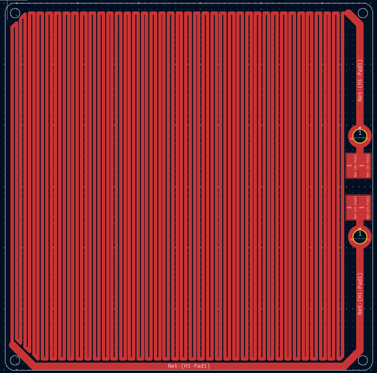
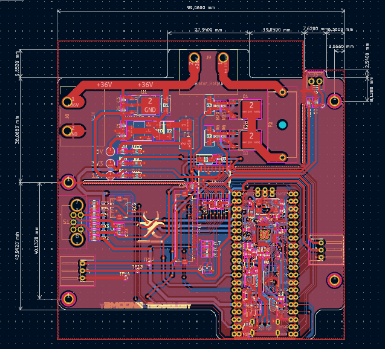

# Hotplate

<p align="left">
  
  
  
  
</p>

**An open-source hotplate project for electronics and PCB work.**

> **Work in Progress** — This project is currently under development. Hardware designs, PCB revisions, documentation, and other project files may change.

## Overview

Hotplate is a DIY electronics project focused on the design and development of a hotplate and its associated control electronics.

This repository is intended to collect the hardware designs, PCB documentation, and project resources as development progresses.

## PCB Designs

### Hotplate Resistor

The custom PCB designed for the hotplate heating element.

<p align="center">
  
</p>

### Hotplate Control Board v1.1

The control electronics PCB, revision v1.1.

<p align="center">
  
</p>

## Repository Structure

```text
Hotplate/
├── img/
│   ├── hotplate-control-board-v1.1.png
│   └── hotplate-resistor.png
├── Kicad/
│   ├── Control board/
│   │   ├── Control board v1.0/
│   │   ├── Control board v1.1/
│   │   └── Control board v1.2/
│   ├── Resistor 10x10/
│   └── Resistor 15x15/
├── Program/
│   ├── lib/
│   ├── Master/
│   ├── Master_prova/
│   ├── backup1/
│   └── backup 2/
├── Simulation and circuits/
└── README.md
```

This tree shows the main project directories. Individual KiCad libraries, 3D models, backup files, and simulation outputs are omitted for readability

